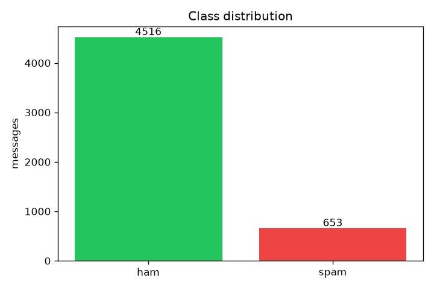
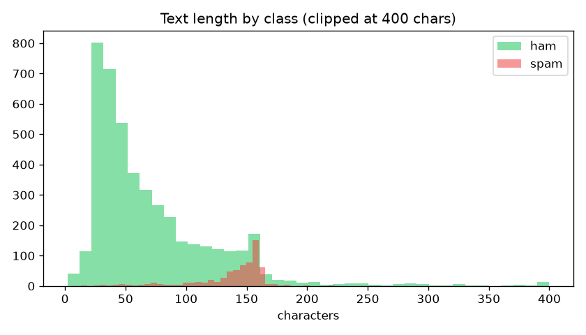

# EDA Report - SMS Spam Collection

- Samples (after cleaning): **5169**
- Duplicates removed: **403**
- Class counts: {'ham': 4516, 'spam': 653} (imbalance ratio 6.9)
- Text length (chars): min 2, median 61, max 910

## Length by class
- **ham**: n=4516, mean 70.9 chars, median 53, max 910
- **spam**: n=653, mean 137.7 chars, median 148, max 223

## Distinctive terms (frequency-based, caveated)

- **ham**: gt, lt, just, ok, lt gt, ll, got, know, like, good
- **spam**: free, txt, ur, stop, mobile, text, claim, reply, www, prize

## Quality problems
- Strong class imbalance (~5:1): accuracy alone is misleading.
- Some messages contain URLs/phone numbers -> normalised to placeholders.
- Exact duplicates were inspected and removed to avoid split leakage.

## Figures

